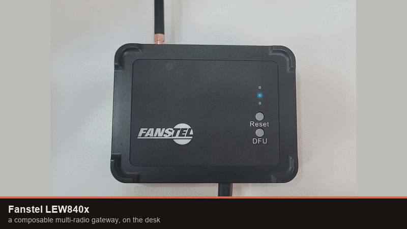

### ESP &amp; nRF · IoT Firmware Debug, Dev &amp; CRA Readiness

**A coding agent for IoT firmware on Espressif ESP and Nordic nRF. It works in VS Code: it builds and flashes your project, reads your board's logs, and helps you fix what it finds.**

  
  
  
  

**[Install](#getting-started)** · **[Docs](https://docs.adsumnetworks.com)** · **[NTN Relay](#adsum-ntn-relay)** · **[CRA readiness](#cra-readiness)** · **[Contributing](#contributing)**

*A run on the Fanstel BLG20x, from an unflashed board to data on your platform. [Step through it](https://docs.adsumnetworks.com/#run)*

The free tier needs no API key, account or card.

## What's New `v0.5.2`

- Windows: the Hardware page finds gateways over Bluetooth again (0.5.1 could not scan on Windows).
- Each session opens in its own editor tab, and you can run several sessions side by side.
- Demo and licensed firmware download into your workspace with their licence, and the agent flashes them from there.
- The Hardware page finds a BLG20x or LBG20x gateway over Bluetooth, pairs with it, claims it, updates both of its processors and commissions it, reading each setting back.

## Getting Started

Install **Adsum IoT Coder** from the Extensions panel, the [VS Code Marketplace](https://marketplace.visualstudio.com/items?itemName=AdsumNetwork.nrf-ai-debugger) or [Open VSX](https://open-vsx.org/extension/AdsumNetwork/nrf-ai-debugger) (Cursor, Windsurf, VSCodium). It runs on Windows, macOS and Linux.

You also need the [nRF Connect Extension Pack](https://marketplace.visualstudio.com/items?itemName=nordic-semiconductor.nrf-connect-extension-pack) for nRF, or an ESP-IDF installation for ESP. See the [requirements](https://docs.adsumnetworks.com/getting-started).

1. Try a sample run. It needs no board.
2. Open your nRF or ESP project. Adsum detects your boards and toolchains and suggests runs: build, flash and debug; add a feature; test; CRA readiness.
3. Describe your task, or pick a run.
4. Register for free to work on cellular, satellite NB-NTN, LoRa and edge AI.
5. To use your own model, choose it in Settings: the GLM Coding Plan, Claude, DeepSeek, OpenRouter, or any OpenAI- or Anthropic-compatible endpoint, including local servers such as Ollama and LM Studio.

## Supported platforms

| Platform | Chips | SDK | Protocols |
|:---|:---|:---|:---|
| **Nordic** | nRF52, nRF53, nRF54L, nRF91 (9160, 9161, 9151) | nRF Connect SDK (Zephyr) | BLE, LoRa / LoRaWAN, NB-IoT, LTE-M, GNSS, NB-NTN |
| **Espressif** | ESP32, ESP32-S3, ESP32-C6 and the rest of the range | ESP-IDF | Wi-Fi, BLE, LoRa / LoRaWAN |
| **Products** | Fanstel LEW840X, BWG840X, BLG20x, LBG20x gateways | both | BLE, Ethernet, Wi-Fi, cellular, NB-NTN |

Adsum works with any board built on a supported chip, including your own designs. Cellular, NB-NTN, LoRa and edge-AI runs, and the gateway firmware, need a free registered account; nothing else does. The nRF54LM20 needs nRF Connect SDK 3.3.0 or later, and NB-NTN needs an nRF9151 of the LACA A1A revision. See [chips and protocols](https://docs.adsumnetworks.com/supported-hardware).

## Adsum NTN Relay

The Adsum NTN Relay is our firmware for two Fanstel gateways. It connects any Bluetooth device to satellite in hours.

- The BLG20x is for indoor use at a fixed site. The LBG20x is for outdoor use, fixed or moving, and finds its own position by GNSS.
- Each relay carries up to 60 Bluetooth IoT devices and sends their data over satellite NB-NTN, or over LTE-M and NB-IoT when a cell is in reach. It uses Wi-Fi where fitted.
- Both gateways are built on Nordic's nRF9151 and nRF54LM20B.
- The [catalogue](https://www.adsumnetworks.com/catalogue/) lists 442 Bluetooth IoT devices, and growing.
- The demo firmware is free. Production licences are sold per relay at [adsumnetworks.com](https://www.adsumnetworks.com), where you can pre-order now; they ship in November.
- In Adsum IoT Coder you can pair, claim, update and commission a relay over Bluetooth, and customise its firmware.

Fanstel designs, makes and sells the hardware. Adsum Networks writes and licenses the firmware. See the [first run](https://docs.adsumnetworks.com/supported-hardware/fanstel/blg20x-first-run).

## What it does

- Detects your board and toolchains, and tells you what is missing.
- Builds, flashes and debugs on the hardware, with live RTT and UART logs on nRF and serial logs on ESP.
- Correlates the application log, HCI and an over-the-air sniffer capture to debug Bluetooth LE.
- Sends AT and Zephyr shell commands, and decodes modem traces.
- Creates projects, and adds features such as a BLE service, a LoRa link, a sensor or storage.
- Keeps a project memory in `.adsum/` in your repository. Any session can be exported as one redacted file.

## CRA readiness

The CRA readiness check runs on your nRF or ESP build. It helps you prepare for the EU Cyber Resilience Act. It is not a conformity assessment and not legal advice.

- An SBOM of your build, in SPDX.
- A scan for known CVEs in EUVD, NVD and OSV, with its coverage stated.
- A check of your configuration for secure boot, signed updates, debug-port lock, secure pairing and secure storage, with a fix for each gap.
- Help to update an affected component, rebuild and check again.

Reports are written to a `compliance/` folder in your project. See the [walkthrough](https://docs.adsumnetworks.com/cra-readiness).

## Benchmark

IoT-FirmwareDebugBench v0.1 runs six Bluetooth LE bugs on nRF52 hardware. With the same model (Claude Haiku 4.5), Adsum IoT Coder fixed 5 of them and Claude Code fixed 3, and Adsum used 3.8 times fewer tokens on average. The benchmark is open source.

| Metric | Adsum IoT Coder | Claude Code |
|:---|:---|:---|
| Bugs fixed (within 7 flashes) | **5 / 6** | 3 / 6 |
| Fixed on the first flash | **4 / 6** | 1 / 6 |
| Tokens per fixed bug | **1.86M** | 7.15M |

See the [benchmark report](./docs/benchmarks/v0.1-report.md).

## Contributing

You can contribute firmware knowledge, credited to you, or code to the extension. See [contributing](https://docs.adsumnetworks.com/contributing), [issues](https://github.com/adsumnetworks/Adsum-IoT-Coder/issues) and [discussions](https://github.com/adsumnetworks/Adsum-IoT-Coder/discussions).

## Limits, privacy and security

Review every change the agent makes before you build, flash or ship. The CVE scan covers components with identifiers (CPE/PURL); it does not find undisclosed vulnerabilities.

The agent and your project memory stay on your machine. Only the context a task needs is sent to the model provider you choose. The optional account signs in through your browser with GitHub or email, and its token is kept in your OS keychain. Analytics are pseudonymous product events and never include your source, chat or device logs. Turn them off with `telemetry.telemetryLevel: off`.

See [limitations](https://docs.adsumnetworks.com/legal/limitations) and [privacy and security](https://docs.adsumnetworks.com/privacy-and-security).

nRF, nRF Connect SDK and Nordic Semiconductor are trademarks of Nordic Semiconductor ASA; ESP32 and ESP-IDF are trademarks of Espressif Systems; Zephyr is a trademark of the Linux Foundation; Visual Studio Code is a trademark of Microsoft. Fanstel is a trademark of its owner. This is an independent project, not affiliated with or endorsed by any of them.

## FAQ

**Does it work in Cursor, Windsurf or VSCodium?** Yes. Install it from [Open VSX](https://open-vsx.org/extension/AdsumNetwork/nrf-ai-debugger).

**Do I need an API key or an account?** No. A free account is needed only for cellular, satellite NB-NTN, LoRa, edge AI and the gateway firmware.

**Does it replace the nRF Connect or ESP-IDF extensions?** No. It works alongside them and uses `west`, `nrfutil`, `idf.py` and `esptool` through those toolchains.

**Can it run with a local model?** Yes, with any OpenAI- or Anthropic-compatible endpoint such as Ollama or LM Studio, if the model supports tool calling well.

**Is the CRA check a certification?** No. It is a readiness aid, not a conformity assessment and not legal advice.

## About

[Adsum Networks](https://www.adsumnetworks.com) makes firmware and tools for IoT engineers. The team has shipped IoT gateways and devices on Nordic nRF for nine years.

## License

The extension is open source under Apache-2.0, © 2026 Adsum Networks, and is derived from [Cline](https://github.com/cline/cline) (see [NOTICE](NOTICE)). Bundled knowledge is under CC-BY-SA-4.0 (see [iot-knowledge/LICENSE](iot-knowledge/LICENSE)). Knowledge delivered to registered accounts carries its own licence, shown when it loads. Gateway firmware is licensed separately; the demo images are free to evaluate.

---

[www.adsumnetworks.com](https://www.adsumnetworks.com) · [Docs](https://docs.adsumnetworks.com) · [GitHub](https://github.com/adsumnetworks/Adsum-IoT-Coder) · [YouTube](https://www.youtube.com/@adsumnetworks)

